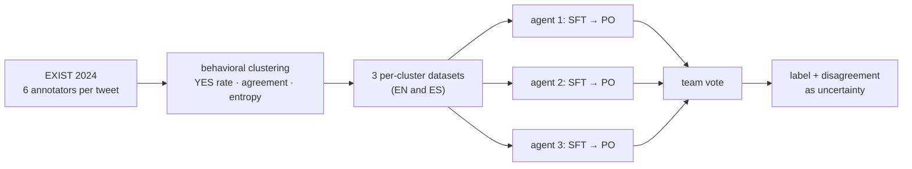
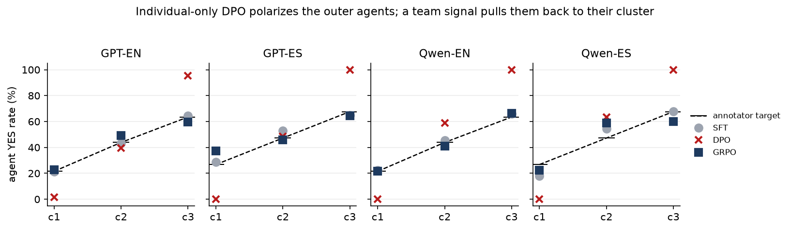

# MAP-PO

[](https://github.com/mohammadi-hadi/MAP-PO/actions/workflows/ci.yml)
[](https://doi.org/10.5281/zenodo.21803548)

Annotators disagree about sexism because they see it differently. MAP-PO keeps those
perspectives instead of averaging them away: it clusters annotators by labeling behavior,
trains one LLM agent per cluster with SFT / DPO / GRPO, and lets the agents vote.

Most sexism-detection systems collapse six annotator labels into one gold label and train on
that, discarding the disagreement. MAP-PO (Multi-Agent Perspectivist Preference Optimization)
treats the disagreement as the signal. Annotators are clustered by **labeling behavior** —
YES rate, agreement rate, and label entropy — into three groups per language. One LLM agent
is fine-tuned per cluster with supervised fine-tuning, then with a preference-optimization
objective (DPO, Mars-PO, or GRPO with a convex individual/team reward). The three agents
vote, and their disagreement doubles as an uncertainty signal.



Clusters use neutral names `cluster1`/`cluster2`/`cluster3`, ordered by ascending YES rate
(display names come from `src/config.py:CLUSTER_DISPLAY`; legacy names in old artifacts are
normalized at load time).

## What it demonstrates

- **Behavioral annotator clustering** — k-means over YES rate, agreement rate, and label
  entropy; demographics are shown *not* to predict cluster membership
- **One agent per perspective** — three fine-tuned agents vote on the final label, and both
  per-cluster fidelity and team accuracy are reported
- **Three optimization stages** — SFT, DPO / Mars-PO (individual preference), and GRPO by
  rejection sampling with a convex individual/team reward
- **Dual backbones** — the OpenAI `gpt-4.1-mini` fine-tuning API and local Qwen3-8B via MLX
  LoRA on Apple Silicon
- **Restart-safe pipelines** — the local runner keeps state in `artifacts/local_state.json`;
  the OpenAI suite resumes from `artifacts/openai_es_state.json`

## Results

Team F1-macro on the full test sets, across two backbones and two languages:

| Stage | GPT-EN | GPT-ES | Qwen-EN | Qwen-ES |
|-------|--------|--------|---------|---------|
| Zero-shot ensemble | 64.7 | 57.4 | 76.8 | 72.9 |
| SFT (mixed) | 89.1 | 84.6 | **84.7** | **81.0** |
| DPO (individual-only) | 85.8 | **85.5** | 78.1 | 80.5 |
| GRPO (α=0.2 team reward) | **89.9** | 85.1 | 80.9 | 80.6 |

GPT-EN also has Mars-PO (88.8) and SFT-pure (88.4); Qwen-EN has a label-balanced SFT ablation
(83.4). Source: `artifacts/results/*.json`.

**[RESULTS.md](RESULTS.md)** presents every experiment (all tables, sweeps, ablations,
fidelity, clustering) in one generated document; per-text agent votes are in
`artifacts/predictions/` (text IDs and labels only — no tweet text, per the EXIST usage
agreement).

### Key findings

- **Zero-shot collapse.** Without fine-tuning the three agents are near-identical: 0.0%
  disagreement in both Qwen settings (identical YES rates 0.427 EN / 0.461 ES), 3.2% on
  GPT-EN. Cluster-specific training is what makes them distinct.
- **DPO polarization, in all four settings.** Individual-only DPO pins the outer agents' YES
  rates to the extremes (0.000/1.000 on Qwen, 0.000/0.997 on GPT-ES, 0.015/0.953 on GPT-EN);
  disagreement saturates at 94–100% and per-cluster calibration is lost everywhere, even
  where the headline Team F1 survives (GPT-ES).
- **A team signal restores calibration every time.** Whether the anchor is implicit in the
  SFT data mix, explicit in Mars-PO's team pairs, or explicit in GRPO's reward, mean YES-rate
  calibration error returns to 2.0–8.0 pp and disagreement to 34–46%.
- **Capacity nuance.** Whether the team reward *also* lifts headline accuracy depends on the
  backbone: GRPO beats SFT on GPT-EN (+0.8 F1) and ties it on GPT-ES, but trails SFT on the
  smaller Qwen3-8B.
- **Label balancing hurts.** Balanced-SFT (Qwen-EN) drops Team F1 84.7 → 83.4 and inflates
  calibration error 1.7 → 10.9 pp; imbalance is handled at the metric level (F1-macro,
  balanced accuracy) instead.



*The polarization result in one picture: in every setting, individual-only DPO (red) pins the
outer agents to 0% / 100% YES, while SFT (gray) and GRPO's team reward (navy) keep every agent
near its cluster's annotator target (dashed). Regenerate from the committed artifacts with
`python3 figures/plot_polarization.py`.*

## Quick start

Local pipeline (no API key, Apple Silicon):

```bash
git clone https://github.com/mohammadi-hadi/MAP-PO.git
cd MAP-PO

# one-time: create the MLX venv
python3 -m venv .venv-mlx && .venv-mlx/bin/pip install -r requirements.txt mlx-lm

# full bilingual pipeline: clustering -> data prep -> SFT/DPO/GRPO -> evals
.venv-mlx/bin/python src/pipeline/run_local_experiments.py            # both languages
.venv-mlx/bin/python src/pipeline/run_local_experiments.py --lang es  # one language
```

The runner is restart-safe (state in `artifacts/local_state.json`, logs in `artifacts/logs/`).

OpenAI suite:

```bash
export OPENAI_API_KEY="your-key-here"
python3 src/training/openai_es_suite.py           # full Spanish gpt-4.1-mini suite (resume-safe)
python3 src/training/openai_es_suite.py --status
```

The English OpenAI experiments (SFT / DPO / Mars-PO / GRPO sweeps) are documented step by step
in `PIPELINE.md`.

## Verification

The repository checks itself:

```bash
pip install -r requirements.txt pytest
pytest                                            # metrics vs scikit-learn + artifact guards
python3 src/evaluation/generate_results_md.py     # regenerate RESULTS.md from artifacts/
```

- The homegrown metrics are tested against scikit-learn on random labelings.
- The committed prediction files are tested to contain text IDs, votes and probabilities
  only — the EXIST data may not be redistributed, and CI enforces that forever.
- `RESULTS.md` is generated from `artifacts/`; CI regenerates it on every push and fails
  if the committed document and the committed artifacts ever disagree.

`python3 src/pipeline/verify_pipeline.py` additionally checks the shipped result JSONs
(format and metric coverage for all four settings) and, once `data/` has been regenerated,
the clustering outputs, data shapes, and splits. Data checks are skipped with a warning on
a fresh clone.

## Why three clusters?

Silhouette prefers k=2 on Spanish, but that solution puts annotators spanning 7% to 89% YES in
one cluster, merging the leanings the agents are meant to separate. At k=3 the mean deviation
between an annotator's YES rate and its own cluster mean drops from 0.099 to 0.059, every
cluster holds at least 17% of annotators, and consecutive cluster means are at least 0.204
apart. Reproduce the diagnostics with:

```bash
python3 src/preprocessing/k_selection.py            # both languages
```

## Repository structure

```
MAP-PO/
├── src/                         All pipeline code; scripts run from repo root
│   ├── config.py                Paths, hyperparameters, cluster naming
│   ├── preprocessing/           clustering, k-selection, data prep, MLX formatting
│   ├── models/                  Agent / MultiAgentSystem
│   ├── training/                sft, dpo, grpo, mlx_*, openai_es_suite
│   ├── evaluation/              evaluate_agents, evaluate_local, metrics, fidelity, plots
│   └── pipeline/                run_local_experiments, orchestrator, verify_pipeline
│
├── artifacts/
│   ├── results/                 Per-method evaluation JSONs (all four settings)
│   ├── predictions/             Per-text agent votes (text IDs and labels only)
│   └── clustering/{en,es}/      Clustering summaries, k-means scans, k-selection
│
├── tests/                       Metric checks vs scikit-learn + artifact guards
├── figures/                     The polarization figure + the script that regenerates it
├── data/                        Regenerated locally from the EXIST source (not distributed)
├── PIPELINE.md                  Step-by-step pipeline guide
├── RESULTS.md                   Every experiment in one generated document
└── requirements.txt
```

## Data

The EXIST 2024 dataset is distributed under a usage agreement and is **not included** in this
repository. Request it from the organizers via the
[EXIST 2024 site](http://nlp.uned.es/exist2024/) (CLEF EXIST lab), then place the training
file at:

```
data/raw/EXIST2024_training.json
```

Everything else (clustering, splits, preference data, MLX datasets) is regenerated from that
file by the pipeline. The evaluation results in `artifacts/results/` and the clustering
summaries in `artifacts/clustering/` are included, so the results tables are reproducible
without the raw data.

## Related work

- [Exist-2023](https://github.com/mohammadi-hadi/Exist-2023) — BERT / XLM-RoBERTa / DistilBERT
  voting ensemble for the EXIST 2023 shared task (CLEF 2023)
- [Sexism-Detection-in-Social-Media](https://github.com/mohammadi-hadi/Sexism-Detection-in-Social-Media)
  — mirror of the EXIST 2023 system notebook
- [Explainable-Sexism-Detection](https://github.com/mohammadi-hadi/Explainable-Sexism-Detection)
  — transparent sexism-detection pipeline with SHAP explanations (Applied Sciences, 2024)

## Citation

The accompanying paper is under double-blind review, so citation metadata is withheld until
it appears (`CITATION_RESTORE.md` documents the restore). Until then, please cite the
Zenodo archive: [10.5281/zenodo.21803549](https://doi.org/10.5281/zenodo.21803549).

## License

The code and result files are released under the MIT License (see [LICENSE](LICENSE)). The
EXIST 2024 data is not included and is governed by its own usage agreement.

## Contact

- **Hadi Mohammadi** — Utrecht University
- Website: [mohammadi.cv](https://mohammadi.cv)

## Acknowledgments

Thanks to the EXIST 2024 (CLEF EXIST lab) organizers for providing the dataset under their
usage agreement.
